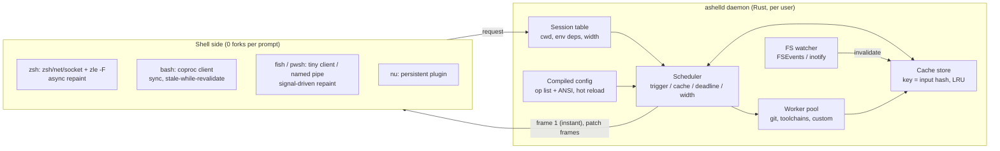
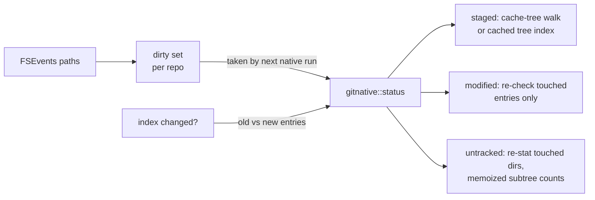

# ashell design

## TLDR

Persistent per-user Rust daemon + zero-fork shell integrations. Every prompt
gets **frame 1** instantly (cached/stale values, <1ms), then **patch frames** as
slow segments finish. Nothing on the critical path ever spawns a process.
Starship takes 536ms in a 23k-file repo; target is <1ms for frame 1.

## Baseline: where Starship loses (macOS, arm64, hyperfine `-N`)

| Case | Time |
|---|---|
| `fork+exec` of `/usr/bin/true` | 3.9 ms |
| `starship prompt` outside a repo | 17.2 ms |
| `git status` in `aports` (23k files) | 88 ms |
| `starship prompt` in `aports` | **536 ms** (`git_status` 514ms, `directory` 16ms) |

Root causes, by size:

1. Git status recomputed from zero every prompt (6x slower than `git` itself).
2. No persistence: config, dir scans and git state rebuilt per prompt.
3. Process spawn per prompt (~4ms on macOS before any work).
4. Toolchain versions via subprocess (`node --version`), capped by a 500ms timeout.
5. Prompt blocks on the slowest module.

## Architecture



### Stack

| Piece | Choice | Why |
|---|---|---|
| Daemon | Rust, `notify`, std threads, no tokio (later: `gix`) | Best git lib, cross-platform watchers, workload is CPU/FS bound |
| zsh | Pure zsh: `zsh/net/socket` + `zsh/system` (`sysread`/`syswrite`) + `zle -Fw` | Zero fork, no compiled module, async repaint |
| bash | `coproc` running a persistent client | Zero fork per prompt (bash 4+) |
| fish / pwsh | Tiny C client (~20KB) / in-process `NamedPipeClientStream` | fish has no socket builtin |
| nushell | Persistent plugin process | Zero spawn |
| Protocol | Unix socket, delimited frames (fields `0x1F`, records `0x1E`) | Single `sysread`/`syswrite` per frame, trivially parseable from zsh, no JSON |

### Daemon

- **Session**: one per shell connection. Holds cwd, width, last exit code, last
  duration, current `seq`, and the values of the env vars segments depend on.
- **Env deps**: each segment declares the env vars it reads. Handshake returns
  the list; the shell sends only those values. The daemon never trusts its own env.
- **Compiled config**: parsed once into an op list with pre-rendered ANSI;
  hot reload on file change.
- **Two-phase render**:
  1. Frame 1: cached values, stale ones dimmed, unknown ones as placeholders.
  2. Patch frames: whole-prompt re-render (render is µs) pushed when a pending
     segment finishes or a late FS event arrives. Frames carry `seq`; the shell
     drops frames for old prompts.
  - zsh repaints via `zle reset-prompt`, fish via signal + `commandline -f repaint`.
  - bash has no async repaint: stale-while-revalidate, optional ~5ms wait.
- **Late-event grace window**: FSEvents can deliver after the next prompt is
  requested. After frame 1 the session keeps listening ~200ms; if the watcher
  fires, it recomputes and patches. Correctness without blocking.
- **Cache**: keyed by input hash (cwd, git index/HEAD, binary realpath+mtime,
  env values). Watcher bumps generations; periodic reconcile covers dropped events.
- **Fallback**: no daemon reachable → same core renders one-shot in-process
  (Starship-style) and the daemon is started detached in the background.

### Lazy loading per segment

A segment runs only if its trigger matches, its cache is stale, and it fits the
width budget.

```toml
[segment.node]
trigger  = { files = ["package.json", ".nvmrc"], ascend = true }
inputs   = { env = ["PATH"], files = [".nvmrc", ".node-version"] }
cache    = "watch"        # watch | ttl:30s | env | never
deadline = "2ms"          # miss: render stale, patch later
priority = 40             # dropped first on narrow terminals
resolve  = ["path", "file", "spawn"]   # spawn is last resort
```

- **Git**: HEAD/branch read straight from `.git` files every prompt (µs).
  Status computed off the critical path and cached per repo, invalidated by the
  watcher. Target implementation: one full parallel index stat-walk per repo,
  then only watcher-dirty paths; honor `core.fsmonitor`/`untrackedCache`;
  above N files show `?` for untracked instead of blocking.
- **Toolchains without spawning**:
  - node: realpath of `node` in `PATH` (nvm/fnm/volta/mise encode the version)
  - python: `pyvenv.cfg`
  - rust: `rust-toolchain.toml` + rustup settings
  - go: `$GOROOT/VERSION`
  - java: `$JAVA_HOME/release`
- **Custom segments**: shell command with declared cache inputs, run in the
  pool. WASM plugins later.

### Low-level performance

- No per-render allocation in steady state: reused buffers, precomputed ANSI,
  shell escaping (`%{ %}` zsh, `\[ \]` bash) chosen at config load.
- Prompt content reaches zsh through a variable with `prompt_subst`, so
  user-controlled text (dir names, branch names) is never re-expanded.
- Display width cached per segment output.
- `lto = "fat"`, `codegen-units = 1`, `panic = "abort"`, PGO on a recorded workload.
- Directory scans cached by (dev, ino, mtime).
- Socket in a 0700 dir, peer uid checked (`getpeereid` / `SO_PEERCRED`).

## Features

- Right prompt, transient prompt, width-based segment dropping.
- Stale values dimmed while revalidating.
- `ashell explain`: per-segment time, cache hit/miss, why it recomputed.
- `ashell bench`: compare against Starship on your own repos.
- `ashell import starship.toml` for migration.
- Memory cap with LRU per repo.

## Roadmap

| Milestone | Scope | Target |
|---|---|---|
| M1 | Daemon, zsh, directory / git / status / duration / character, one-shot fallback | Frame 1 <0.5ms in `aports` warm, git never blocks |
| M1.5 | Native git status (gitoxide + in-memory untracked cache), upgrade restart, watcher-failure fallback | Warm status < `git status` |
| M1.6 | Watcher-dirty set: skip the per-dir stat walk, O(changed) warm status | aports warm < 10ms: **done**, edits 0.6-1.4ms, `git add` 17ms |
| M2 | bash, fish, toolchains, config file + hot reload, `explain`, `bench` | |
| M3 | Custom segments, Starship config import | |
| M4 | nushell, PowerShell, WASM plugins | |

## M1 status

Done: daemon, zsh integration (zero fork, async repaint), directory / git /
status / duration / character, one-shot fallback with daemon auto-spawn,
`ashell explain`, e2e test (`tests/e2e.sh`), zsh bench (`bench/precmd.zsh`).

Try it: `cargo build --release && eval "$(target/release/ashell init zsh)"`

### Measured (`aports`, 23k files, macOS arm64)

| What | Time |
|---|---|
| Daemon render, warm (`ashell explain`, p50 of 500) | 4.5 µs (p99 77 µs) |
| Full prompt as zsh sees it (`bench/precmd.zsh`) | **115 µs** (85 µs outside a repo) |
| Fork baseline `$(true)` | 3.9 ms |
| `ashell prompt` one-shot fallback | 91 ms (git status inline) |
| `starship prompt` | 544 ms |
| Async git status (off critical path) | 120-210 ms, then cached until the watcher fires |

### Lessons

- `open()` costs ~100µs on this machine (likely endpoint security), `stat()` ~3µs.
  File-derived values (HEAD, stash) are cached by (ino, mtime, size). Per-prompt
  `2>/dev/null` in zsh was costing ~125µs for the same reason.
- Interactive zsh dies on SIGPIPE when writing to a dead daemon (exit 13). The
  send is wrapped in a scoped `trap '' PIPE` (9µs); `syswrite` then fails
  silently with rc 2 and the prompt falls back to one-shot.
- `notify` FSEvents already uses latency 0 + `NoDefer`.
- `inotify` recursive watch setup is slow on big trees, so watchers start off
  the render path and cache entries are never trusted until the watcher is up.

## M1.5 status

Done:

- **Native git status** (`src/gitnative.rs`): gitoxide for index/worktree
  stat walk, HEAD-tree vs index and ahead/behind. No subprocess.
- **In-memory untracked cache** (`src/untracked.rs`): git's untracked cache
  idea, kept in daemon memory. Each dir's listing and ignore classification is
  keyed by (ino, mtime); re-runs `stat` dirs instead of `readdir` (3µs vs
  ~90µs here). `.gitignore` edits drop the affected subtree, global exclude
  edits drop everything. Honors `core.ignoreCase`.
- **Cold start**: while a repo's cache is cold, status comes from `git` (which
  has its own on-disk untracked cache) and the native cache warms in the
  background. One-shot mode always uses `git` for the same reason.
- **Upgrade restart**: the daemon exits when its binary changes; the next
  prompt falls back once and spawns the new build.
- **No watcher**: a cached status is fresh only if computed after the prompt
  was requested, so no recompute loops. Native failure falls back to `git`,
  then to "clean".
- Repo discovery skips `.git` dirs without `HEAD`, like git.

### Correctness

- `tests/git-diff.sh`: native vs `git status --porcelain=v2` on every local
  repo. **304/304 match**, cold and warm.
- `native_matches_git_through_mutations` test: one repo mutated through 22 steps
  with a warm cache (nested/ignored dirs, `.gitignore` create/edit/remove,
  nested repo, staged+modified, intent-to-add, case-only rename, deletes,
  ahead, behind, conflict), compared to git after each step.

### Measured

| Repo | native warm | `git status` | native cold |
|---|---|---|---|
| aports (23k files, 12.5k dirs, git untracked cache on) | 68-78 ms | 80-86 ms | 1.5 s (hidden: git answers while warming) |
| astro (7k files, no untracked cache) | 21-24 ms | 280-350 ms | 360 ms |
| All 304 local repos, summed | **4.1 s** | 16.4 s | 26 s |

Native warm is faster than git in 303/304 repos. In the shell (e2e): first
visit to aports shows the status 180ms after `cd`; revisits are instant from
cache. Prompt cost in zsh unchanged: 108-135 µs.

### Lessons

- gix's dirwalk has no untracked cache: 1.07s of 1.1s in aports was `readdir`.
  git without its untracked cache takes the same 1.24s.
- macOS repos default to `core.ignoreCase=true`: index lookups must fold case
  or case-only renames show up as untracked.

## M1.6 status

Done: watcher-driven incremental git status. Each recompute costs O(what
changed) instead of O(repo).



- **Dirty set**: the watcher records changed workdir paths; only native runs
  consume it, so no change is lost between them. Dropped events
  (`need_rescan`) or >20k paths fall back to a full pass. A run seeds the next
  incremental one only if the watcher was live when it started (warm-up waits
  up to 200ms for it).
- **Modified/conflicted**: kept as path sets. Re-checked entries = watcher
  paths that are tracked (or dirs/submodules holding them) + index entries
  that changed since last run (old vs new index diff). Calls
  `gix_status::index_as_worktree` directly with a per-index-version cached
  context (attributes stack, filter pipeline, submodule list): gix's
  high-level API rebuilt it every call (~3.5ms, mostly an unused icase table).
- **Staged**: like git, walk the index cache-tree against HEAD's trees and
  only descend into subtrees git marked changed (nothing right after a
  commit). Falls back to a full diff against a cached flattened HEAD tree
  when renames could pair adds with deletes, or on conflicts/ITA/sparse.
  This also fixed a corrupt repo (missing tree object) that git handles via
  cache-tree and native couldn't.
- **Untracked**: dirs not touched by the watcher skip `stat`; each child dir
  keeps a memoized count in its parent's listing, invalidated along the
  ancestors of changed paths and changed index entries. Changed dirs
  revalidate their whole subtree (a dir moved out, edited and moved back).
- **Small stuff that showed up in profiles**: HEAD tree + ahead/behind cached
  by `stat` of HEAD, the branch/upstream loose refs and packed-refs
  (0.4-5ms); icase tables cached per index version (2.5ms); index checksum
  skipped (`index.skipHash`, 2.7ms of the 5.7ms read: git writes by atomic
  rename); excludes stack built only when a dir is re-read (0.6ms).
- After 3 consecutive native failures a repo is served by `git` only.
- Debug: `ASHELL_DEBUG=1` logs timings/decisions, `ASHELL_LOG=<file>` keeps
  a detached daemon's stderr, `ashell git-watch` prints every recompute.

### Correctness

- `tests/git-diff.sh`: **513/513 match** git, cold and warm (now also
  `~/projects`).
- Mutation steps grew from 22 to 42 (submodule add/content/commit, staged
  add/delete/rename/exec bit, dir replaced by file, move dir out + edit +
  move back, root `.gitignore` rule removal, revert edits, branch switch).
  Run twice: full mode, and `watcher_incremental_matches_git` driving the real
  FSEvents watcher (every step after the baseline runs incremental). In tests every cache-tree
  staged result is also cross-checked against the full diff (24 per run).

### Measured (aports clone, 23k files, warm daemon)

| Operation | M1.5 recompute | M1.6 recompute | Prompt correct after (e2e) |
|---|---|---|---|
| new/removed untracked file | ~70 ms | 0.2-1.4 ms | 13-15 ms |
| edit tracked file | ~70 ms | 0.6-0.8 ms | 15 ms |
| `git add` | ~80 ms | 16-18 ms | 18 ms |
| `git commit` | ~80 ms | 15 ms | |
| `git reset --hard` | ~80 ms | 1.6-13 ms | 7 ms |
| nothing changed | ~70 ms | 0.04 ms | first frame |

"Prompt correct after" is zsh-side, from precmd to the frame being applied;
FSEvents delivery is ~10ms of it. While the native cache warms after the first
visit (~1.5s cold scan), `git` answers: ~105 ms. Full passes (no watcher):
513 repos 3.0 s vs git 26.5 s. Daemon RSS with aports loaded: 33 MB.

### Lessons

- The cost moved to setup, not checks: once the walks were incremental, each
  ~1-3ms of per-call setup (icase table, attribute stacks, tree flattening,
  index checksum) dominated. Cache per index version.
- git's cache-tree is the cheap answer for "what's staged" and is valid right
  after the most common operation (commit).
- Polling tmux to time repaints has ~50ms resolution here (process spawns
  under EDR); timestamp inside zsh instead.

### Next

- First frame after a command can show the previous status for ~10-20ms
  (FSEvents delivery). Possible fix: `FSEventStreamFlushSync` on prompt
  requests, needs our own FSEvents binding.
- Parallel cold scan (12.5k readdirs, 1.5s in aports) to shorten the warm-up.
- M2.

## Risks

| Risk | Mitigation |
|---|---|
| Stale cache from dropped watcher events | Grace window + periodic reconcile + index checksum |
| Daemon env diverges from shell | Declared env deps sent per request |
| macOS FSEvents latency | `NoDefer` flag + grace window |
| Our own `git status` writing `.git/index` and re-triggering the watcher | `git --no-optional-locks`; ignore `.git/objects`, `*.lock` |
