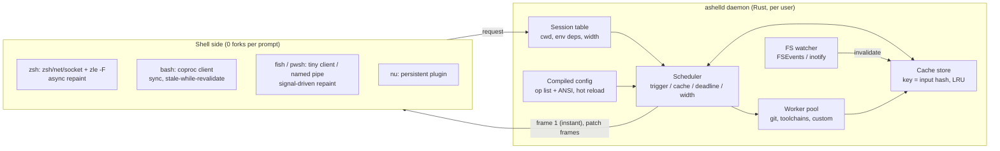

# ashell design

## TLDR

Persistent per-user Rust daemon + zero-fork shell integrations. Every prompt
gets **frame 1** instantly (cached/stale values, <1ms), then **patch frames** as
slow segments finish. Nothing on the critical path ever spawns a process.
Starship takes 536ms in a 23k-file repo; target is <1ms for frame 1.

## Baseline: where Starship loses (macOS, arm64, hyperfine `-N`)

| Case | Time |
|---|---|
| `fork+exec` of `/usr/bin/true` | 3.9 ms |
| `starship prompt` outside a repo | 17.2 ms |
| `git status` in `aports` (23k files) | 88 ms |
| `starship prompt` in `aports` | **536 ms** (`git_status` 514ms, `directory` 16ms) |

Root causes, by size:

1. Git status recomputed from zero every prompt (6x slower than `git` itself).
2. No persistence: config, dir scans and git state rebuilt per prompt.
3. Process spawn per prompt (~4ms on macOS before any work).
4. Toolchain versions via subprocess (`node --version`), capped by a 500ms timeout.
5. Prompt blocks on the slowest module.

## Architecture



### Stack

| Piece | Choice | Why |
|---|---|---|
| Daemon | Rust, `notify`, std threads, no tokio (later: `gix`) | Best git lib, cross-platform watchers, workload is CPU/FS bound |
| zsh | Pure zsh: `zsh/net/socket` + `zsh/system` (`sysread`/`syswrite`) + `zle -Fw` | Zero fork, no compiled module, async repaint |
| bash | `coproc` running a persistent client | Zero fork per prompt (bash 4+) |
| fish / pwsh | Tiny C client (~20KB) / in-process `NamedPipeClientStream` | fish has no socket builtin |
| nushell | Persistent plugin process | Zero spawn |
| Protocol | Unix socket, delimited frames (fields `0x1F`, records `0x1E`) | Single `sysread`/`syswrite` per frame, trivially parseable from zsh, no JSON |

### Daemon

- **Session**: one per shell connection. Holds cwd, width, last exit code, last
  duration, current `seq`, and the values of the env vars segments depend on.
- **Env deps**: each segment declares the env vars it reads. Handshake returns
  the list; the shell sends only those values. The daemon never trusts its own env.
- **Compiled config**: parsed once into an op list with pre-rendered ANSI;
  hot reload on file change.
- **Two-phase render**:
  1. Frame 1: cached values, stale ones dimmed, unknown ones as placeholders.
  2. Patch frames: whole-prompt re-render (render is µs) pushed when a pending
     segment finishes or a late FS event arrives. Frames carry `seq`; the shell
     drops frames for old prompts.
  - zsh repaints via `zle reset-prompt`, fish via signal + `commandline -f repaint`.
  - bash has no async repaint: stale-while-revalidate, optional ~5ms wait.
- **Late-event grace window**: FSEvents can deliver after the next prompt is
  requested. After frame 1 the session keeps listening ~200ms; if the watcher
  fires, it recomputes and patches. Correctness without blocking.
- **Cache**: keyed by input hash (cwd, git index/HEAD, binary realpath+mtime,
  env values). Watcher bumps generations; periodic reconcile covers dropped events.
- **Fallback**: no daemon reachable → same core renders one-shot in-process
  (Starship-style) and the daemon is started detached in the background.

### Lazy loading per segment

A segment runs only if its trigger matches, its cache is stale, and it fits the
width budget.

```toml
[segment.node]
trigger  = { files = ["package.json", ".nvmrc"], ascend = true }
inputs   = { env = ["PATH"], files = [".nvmrc", ".node-version"] }
cache    = "watch"        # watch | ttl:30s | env | never
deadline = "2ms"          # miss: render stale, patch later
priority = 40             # dropped first on narrow terminals
resolve  = ["path", "file", "spawn"]   # spawn is last resort
```

- **Git**: HEAD/branch read straight from `.git` files every prompt (µs).
  Status computed off the critical path and cached per repo, invalidated by the
  watcher. Target implementation: one full parallel index stat-walk per repo,
  then only watcher-dirty paths; honor `core.fsmonitor`/`untrackedCache`;
  above N files show `?` for untracked instead of blocking.
- **Toolchains without spawning**:
  - node: realpath of `node` in `PATH` (nvm/fnm/volta/mise encode the version)
  - python: `pyvenv.cfg`
  - rust: `rust-toolchain.toml` + rustup settings
  - go: `$GOROOT/VERSION`
  - java: `$JAVA_HOME/release`
- **Custom segments**: shell command with declared cache inputs, run in the
  pool. WASM plugins later.

### Low-level performance

- No per-render allocation in steady state: reused buffers, precomputed ANSI,
  shell escaping (`%{ %}` zsh, `\[ \]` bash) chosen at config load.
- Prompt content reaches zsh through a variable with `prompt_subst`, so
  user-controlled text (dir names, branch names) is never re-expanded.
- Display width cached per segment output.
- `lto = "fat"`, `codegen-units = 1`, `panic = "abort"`, PGO on a recorded workload.
- Directory scans cached by (dev, ino, mtime).
- Socket in a 0700 dir, peer uid checked (`getpeereid` / `SO_PEERCRED`).

## Features

- Right prompt, transient prompt, width-based segment dropping.
- Stale values dimmed while revalidating.
- `ashell explain`: per-segment time, cache hit/miss, why it recomputed.
- `ashell bench`: compare against Starship on your own repos.
- `ashell import starship.toml` for migration.
- Memory cap with LRU per repo.

## Roadmap

| Milestone | Scope | Target |
|---|---|---|
| M1 | Daemon, zsh, directory / git / status / duration / character, one-shot fallback | Frame 1 <0.5ms in `aports` warm, git never blocks |
| M1.5 | Native git status (parallel stat walk, watcher-dirty set) replacing `git status` in the worker | Cold status < `git status`, warm O(changed) |
| M2 | bash, fish, toolchains, config file + hot reload, `explain`, `bench` | |
| M3 | Custom segments, Starship config import | |
| M4 | nushell, PowerShell, WASM plugins | |

## M1 status

Done: daemon, zsh integration (zero fork, async repaint), directory / git /
status / duration / character, one-shot fallback with daemon auto-spawn,
`ashell explain`, e2e test (`tests/e2e.sh`), zsh bench (`bench/precmd.zsh`).

Try it: `cargo build --release && eval "$(target/release/ashell init zsh)"`

### Measured (`aports`, 23k files, macOS arm64)

| What | Time |
|---|---|
| Daemon render, warm (`ashell explain`, p50 of 500) | 4.5 µs (p99 77 µs) |
| Full prompt as zsh sees it (`bench/precmd.zsh`) | **115 µs** (85 µs outside a repo) |
| Fork baseline `$(true)` | 3.9 ms |
| `ashell prompt` one-shot fallback | 91 ms (git status inline) |
| `starship prompt` | 544 ms |
| Async git status (off critical path) | 120-210 ms, then cached until the watcher fires |

### Lessons

- `open()` costs ~100µs on this machine (likely endpoint security), `stat()` ~3µs.
  File-derived values (HEAD, stash) are cached by (ino, mtime, size). Per-prompt
  `2>/dev/null` in zsh was costing ~125µs for the same reason.
- Interactive zsh dies on SIGPIPE when writing to a dead daemon (exit 13). The
  send is wrapped in a scoped `trap '' PIPE` (9µs); `syswrite` then fails
  silently with rc 2 and the prompt falls back to one-shot.
- `notify` FSEvents already uses latency 0 + `NoDefer`.
- `inotify` recursive watch setup is slow on big trees, so watchers start off
  the render path and cache entries are never trusted until the watcher is up.

### Next (M1.5)

- Native git status replacing `git status` in the worker.
- Daemon version handshake: restart on binary upgrade (today: `ashell stop`).
- If the watcher can't start, the follow-up loop recomputes git status until the
  10s hard limit; needs backoff.

## Risks

| Risk | Mitigation |
|---|---|
| Stale cache from dropped watcher events | Grace window + periodic reconcile + index checksum |
| Daemon env diverges from shell | Declared env deps sent per request |
| macOS FSEvents latency | `NoDefer` flag + grace window |
| Our own `git status` writing `.git/index` and re-triggering the watcher | `git --no-optional-locks`; ignore `.git/objects`, `*.lock` |
