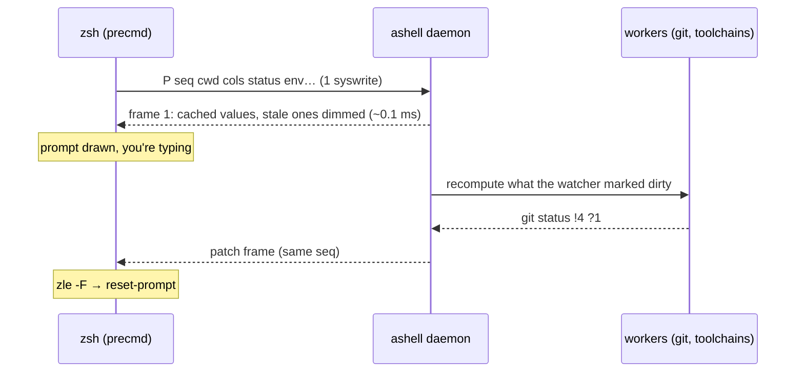
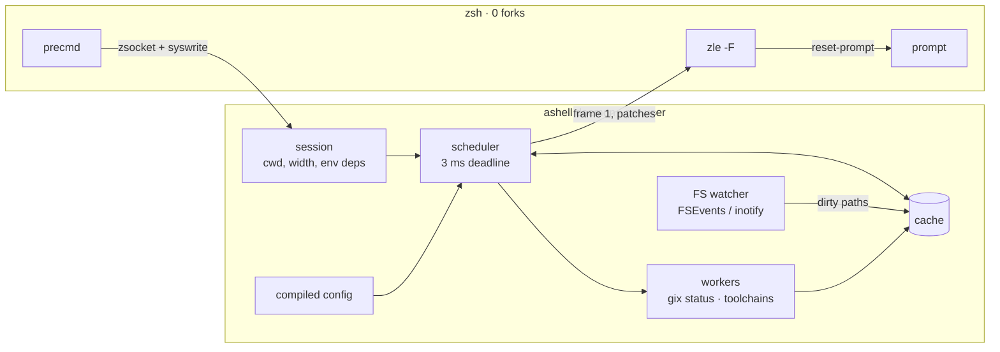

<p align="center">
  <a href="https://hood.github.io/ashell/"></a>
</p>

<p align="center">
  <a href="https://hood.github.io/ashell/"></a>
  
  
  
  
</p>

<h3 align="center">A shell prompt that never makes you wait.</h3>

**TLDR:** a tiny per-user Rust daemon keeps your prompt's state warm. zsh talks to it over a unix socket with builtins only (zero forks), gets **frame 1 in ~115 µs** from cache, and gets patched as slow stuff like git status finishes. Even in a 23k-file repo, your prompt never waits on git.

```sh
cargo install --locked --git https://github.com/hood/ashell
echo 'eval "$(ashell init zsh)"' >> ~/.zshrc
```

> [!NOTE]
> Needs **Rust 1.88+** (`rustc --version`; upgrade with `rustup update`). Older toolchains stop before compiling with `ashell requires rustc 1.88`.

---

## ⚡ Numbers

macOS arm64, [alpine/aports](https://gitlab.alpinelinux.org/alpine/aports) (23k files, 12.5k dirs). Measured inside zsh with `$EPOCHREALTIME` ([`bench/precmd.zsh`](bench/precmd.zsh)) and hyperfine.

| What | Time per prompt | |
|---|---:|---|
| **ashell** (zsh → daemon, warm) | **115 µs** | 🟩 |
| **ashell**, outside a repo | **85 µs** | 🟩 |
| `fork+exec /usr/bin/true` | 3.9 ms | ⬛ the floor for anything that spawns |
| `starship prompt`, outside a repo | 17.2 ms | 🟥 |
| `git status` itself | 88 ms | ⬛ |
| `ashell prompt` one-shot (no daemon) | 91 ms | ⬛ |
| `starship prompt` | **544 ms** | 🟥 `git_status` alone: 514 ms |

> [!TIP]
> ashell's full round trip is **~34x cheaper than forking `true`**. Any prompt that shells out per render can't get below 4 ms on macOS. ashell doesn't shell out.

Inside the daemon, a warm render is **~10 µs** (p99 ~40 µs). Run `ashell explain` to see your own:

```text
frame 1, cold :     1.6ms  pending=true
frame 1, warm :    10.0µs  p50 of 500, p99 26.9µs, pending=false
frame 1, new prompt:     9.9µs  p50 of 200, p99 41.3µs, pending 0/200
  discover  :     4.2µs
  directory :     1.5µs
  git       :     3.6µs
  rest      :   500.0ns
git status (async, off critical path): 31.5ms
```

## 🧠 How it works

Most prompts block on their slowest module. ashell draws **now** and patches **later**.





- **Zero-fork zsh side.** Pure zsh builtins: `zsh/net/socket`, `sysread`/`syswrite`, `zle -Fw`. Frames are `0x1F`/`0x1E` delimited: one syscall each way, no JSON, no parsing library.
- **Safe by construction.** Prompt text reaches zsh through a variable with `prompt_subst`, so a branch named `$(rm -rf ~)` is just text. Socket lives in a 0700 dir, peer uid is checked.
- **Stale, never wrong.** Cached values render dimmed while they revalidate. The daemon keeps listening ~250 ms after frame 1 for late FS events and patches if anything moved.
- **Unkillable UX.** No daemon? The same engine renders one-shot in-process and spawns the daemon detached. Daemon killed mid-session, dead socket, SIGPIPE: falls back, reconnects next prompt. Rebuild the binary and the daemon restarts itself.

## 🌿 Git status in O(what changed)

Native status on [gitoxide](https://github.com/GitoxideLabs/gitoxide) plus an in-memory untracked cache, driven by the filesystem watcher's dirty set. No `git` subprocess once warm.

| After you… | Full recompute | **ashell (incremental)** | Speedup |
|---|---:|---:|---:|
| do nothing | 70 ms | **0.04 ms** | 1750x |
| add/remove a file | 70 ms | **0.2-1.4 ms** | 50x+ |
| edit a tracked file | 70 ms | **0.6-0.8 ms** | ~90x |
| `git reset --hard` | 80 ms | **1.6-13 ms** | 6x+ |
| `git commit` | 80 ms | **15 ms** | ~5x |
| `git add` | 80 ms | **16-18 ms** | ~4.5x |

<sub>aports, warm daemon. The prompt shows the right status 13-18 ms after a command, ~10 ms of which is FSEvents delivery.</sub>

What makes it cheap:

- **Untracked cache in memory**: each dir's listing keyed by `(ino, mtime)`. `stat` (3 µs) instead of `readdir` (~90 µs); untouched dirs aren't even stat'd, child counts are memoized.
- **Staged via cache-tree**: walk git's own index cache-tree against HEAD and only descend where git marked changes. Right after a commit, that's nothing.
- **Setup cached per index version**: icase tables, attribute stacks, HEAD trees, ahead/behind. Once the walks went incremental, 1-3 ms setup costs were the whole bill.
- **Cold start never blocks**: while the native cache warms, `git` (with its on-disk untracked cache) answers.

**Correctness:** compared against `git status --porcelain=v2` on every local repo: **513/513 match**, cold and warm. Full passes across all 513: **3.0 s vs git's 26.5 s**. Plus a 42-step mutation suite (submodules, case-only renames, conflicts, intent-to-add, ignore rule edits, dir↔file swaps, branch switches) run both in full mode and through the real FSEvents watcher.

## 🛠 Toolchains, no spawn tax

🦀 rust · ⬢ node · 🐍 python (+ venv) · 🐹 go · 💎 ruby · ☕ java · 🥟 bun · 🦕 deno

Detected like starship (marker files, extensions). The version is keyed on the resolved binary's `stat`, pin files up the tree (`rust-toolchain.toml`, `.nvmrc`, `.python-version`, `go.mod`, `.tool-versions`, `mise.toml`…), global defaults and env. The tool runs again only when that key changes (or every 30 min, for in-place upgrades behind shims), on a 4-thread pool, never on the render path.

| Dir | Per prompt, zsh-side |
|---|---:|
| no repo | 110 µs |
| aports (git) | 115 µs |
| rust repo (git + toolchain) | 125 µs |
| java service (git + toolchain) | 127 µs |

## 🎨 Config

`$ASHELL_CONFIG`, else `$XDG_CONFIG_HOME/ashell/config.toml`, else `~/.config/ashell/config.toml`. Every key is optional.

```sh
ashell config default > ~/.config/ashell/config.toml   # documented defaults
ashell config check                                     # validate, with line numbers
ashell stop                                             # apply (no hot reload yet)
```

Default prompt:

```text
ashell  main !2 ?1 🦀 v1.99.1 ❯                                     41.2s 1
```

Powerline in ~20 lines ([`examples/powerline.toml`](examples/powerline.toml)):

```toml
left = [
  { text = "cap", style = "bg:#1B2B34 fg:#C0C5CE" },
  "directory", "git", "newline",
]
add_newline = true
separator = "\ue0b4"   # rounded powerline cap, needs a Nerd Font
padding = " "

[directory]
truncate = 3
style = "bg:#2B4A5E fg:#E0E6EB"

[git]
branch_style = "bg:#5FB3B3 fg:#1B2B34"
stash = "$"
hide_counts = ["stash"]
```

- **Layout**: `left` / `right` lists. Leave a segment out and its work is skipped entirely. Extras: `"newline"` and literal `{ text, style }`.
- **Styles**: Starship-like words: `bold cyan`, `bright-red`, `fg:208`, `bg:#1e1e2e`, `none`.
- **Strict**: unknown keys, bad styles and typos are errors. A broken file falls back to defaults and shows `⚠ config` instead of killing your prompt.

## 📟 Commands

| Command | What it does |
|---|---|
| `ashell init zsh` | print the zsh integration (`eval` it) |
| `ashell explain` | per-segment timings, cold/warm, p50/p99, async git time |
| `ashell config path\|check\|default` | where the config lives, validate it, print defaults |
| `ashell stop` | stop the daemon (next prompt spawns a fresh one) |
| `ashell prompt` | one-shot render, no daemon |
| `ashell git-status [--backend native\|cli] [--warm [--trust]]` | status counts + timing |
| `ashell git-watch` | recompute on every FS event, print timings |

Debugging: `ASHELL_DEBUG=1` logs timings and decisions to stderr, `ASHELL_LOG=<file>` keeps a detached daemon's stderr.

## 🧪 Testing

```sh
cargo test                        # unit + git mutation suites (full and watcher-driven)
tests/e2e.sh [big-repo]           # real zsh in an isolated tmux server, prompt after each step
tests/git-diff.sh                 # native status vs git on every repo under ~
bench/precmd.zsh <dir> [n]        # per-prompt cost as zsh sees it, vs fork and starship
```

## 🗺 Roadmap

| | Scope | Status |
|---|---|---|
| **M1** | daemon, zero-fork zsh, directory / git / status / duration / character, one-shot fallback | ✅ |
| **M1.5** | native git status, in-memory untracked cache, self-restart on upgrade | ✅ |
| **M1.6** | watcher-driven incremental status, O(changed) | ✅ |
| **M2** | toolchains ✅, config file ✅, `explain` ✅, `bench`, bash, fish | 🚧 |
| **M3** | custom segments, starship config import, hot reload | 🔜 |
| **M4** | nushell, PowerShell, WASM plugins | 🔜 |

Deep dive, design decisions and every measurement: [`DESIGN.md`](DESIGN.md).

## License

[MIT](LICENSE)
